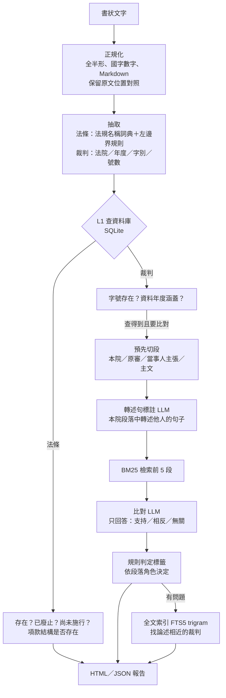

# citecheck — 書狀引用查核器

檢查書狀中引用的**法條**與**最高法院民事裁判**：在資料庫裡查不查得到，以及（選用）書狀的說法是不是最高法院自己的見解。

> **本工具僅提供引用查核輔助，不構成法律意見，也不能取代律師。** 標示為綠色的引用仍請自行點連結核對原文。

---

# 第一部分：給使用者

## 它能幫你抓到什麼

| 問題 | 例子 | 需要 AI？ |
|---|---|---|
| 法規名稱或條號不存在 | 「民法第9999條」 | 不需要 |
| 引用已廢止的法規 | 「動員戡亂時期臨時條款」 | 不需要 |
| 引用尚未施行的條文 | 條文已公布但還沒生效 | 不需要 |
| 裁判字號查不到 | 號數寫錯、年度打錯 | 不需要 |
| 把**原審**或**當事人**的說法當成最高法院見解 | 引用判決裡「原審以…」那段 | 需要 |
| 書狀說法與判決**相反** | 判決說「不得單獨行使」，書狀寫「得單獨行使」 | 需要 |
| 判決裡**根本沒談**這件事 | 字號是真的，內容對不上 | 需要 |
| 民法條文內容與書狀敘述不符 | 把「無效」寫成「有效」 | 需要 |

找不到或對不上時，報告會列出**論述相近的最高法院裁判**讓你自己去看（不是建議引用）。

## 報告怎麼看

每筆引用都有顏色**和**文字標籤（不只靠顏色）：

| 標籤 | 意思 |
|---|---|
| 🟥 請確認 | 查不到，或與裁判論述相反，請優先處理 |
| 🟧 請留意 | 查得到，但有需要留意的情形（例如已廢止、尚未施行） |
| ⬜ 無法查核／僅確認字號 | 不在本工具範圍，或只確認了字號、沒有比對內容 |
| 🟩 查得到 | 資料中查得到；有比對內容時代表與最高法院見解相符 |

每筆都附上連結（全國法規資料庫條文、司法院裁判書 PDF）、裁判主文，以及**被當成依據的那一段原文**，方便你自己核對。

## 快速開始

需要先安裝 [Docker](https://www.docker.com/)。在專案資料夾執行：

```bash
docker build -t citecheck .
```

開啟本機網頁（只有你的電腦連得到）：

```bash
docker run --rm -p 127.0.0.1:8000:8000 -v "${PWD}:/app" -w /app citecheck citecheck serve --host 0.0.0.0 --port 8000
```

用瀏覽器開 http://127.0.0.1:8000/ ，貼上書狀文字，按「開始查核」。`samples/` 裡有範本可以試。

要比對內容（AI），先設定環境變數再啟動，並在啟動指令加上 `-e CITECHECK_PROVIDER -e CITECHECK_MODEL -e OPENAI_API_KEY`：

```powershell
$env:CITECHECK_PROVIDER = "openai"      # 或 anthropic（預設）
$env:CITECHECK_MODEL = "模型名稱"
$env:OPENAI_API_KEY = "你的金鑰"         # anthropic 則設 ANTHROPIC_API_KEY
```

> 勾選「同時比對內容是否相符」時，**含有引用的句子**會傳送到外部 AI 服務。請先刪除姓名、身分證字號、地址等個人資料。不勾選時完全不對外連線。

## 範本

| 檔案 | 預期結果 | 需要 AI？ |
|---|---|---|
| `samples/01_全部查得到.txt` | 法條與判決都查得到 | 不需要 |
| `samples/02_條次查無.txt` | 該法沒有這個條次 | 不需要 |
| `samples/03_資料庫沒涵蓋的判決.txt` | 資料庫沒有涵蓋這個年度 | 不需要 |
| `samples/04_已廢止法規.txt` | 已廢止法規 | 不需要 |
| `samples/05_找得到但主張與判決相反.txt` | 字號存在，但書狀說法與判決相反 | 需要 |

## 它不做什麼

- 不判斷你的主張有沒有道理、會不會勝訴。
- 不查高等法院、地方法院、刑事、行政裁判，也不查判例、決議、大法官解釋（會標示「無法查核」或列在「其他依據」）。
- 不保證資料是最新的：報告頁尾會寫出法規資料日期與已匯入的裁判月份。

---

# 第二部分：給技術人員

## 架構



## 為什麼可以相信它的判斷（防誤判設計）

這個工具的原則是**寧可說「不確定」，也不要給錯的綠色**。

1. **LLM 不決定「這是誰的見解」。** 比對用的 LLM 只看到一句主張和幾段原文，只回答每段是「支持／相反／無關」與信心分數；**不會**收到段落的角色。誰說的（本院、原審、當事人）由切段規則決定，最後的標籤由固定的規則表算出，同樣的輸入一定得到同樣的結果。
2. **LLM 不能用自己的法律知識。** 提示詞明確要求只依提供的段落判斷；沒有把握就選「無關」並給低分。信心低於門檻（0.6）的回答不計入。
3. **本院段落裡的轉述句會被拆出來。** 最高法院常寫「原審以……」再加以駁斥。第一次使用某份裁判時，會先讓 LLM 標出本院段落中「轉述原審或當事人」的句子並永久存起來；這些句子在比對時改用被轉述者的角色，不會被誤當成最高法院見解。標註失敗時，該裁判不會給綠色。
4. **互相矛盾時不給答案。** 本院段落中同時有「支持」和「相反」，結果是「不確定」，不是取高分。
5. **程序性裁定不給綠色。** 「上訴不合法」而駁回的裁定沒有實質見解，比對結果最多是「不確定」。
6. **查不到不等於不存在。** 只有在資料庫確實涵蓋該年度、而且查詢落空時，才會說「查不到」；資料沒涵蓋就明說「資料沒有涵蓋」。
7. **相近裁判的門檻更嚴。** 信心至少 0.8、該段不得含轉述句、最多列 3 筆，用語固定為「僅供自行查閱」，絕不出現「建議引用」「錯誤引用」等字眼。
8. **輸出格式錯誤就重試一次，仍失敗就標「不確定」**，不會猜。原始輸出記錄在失敗日誌供除錯。
9. **有評測工具。** `eval/` 有分類型的測試集（正確引用、當事人主張、原審見解、方向相反、張冠李戴、查無字號、範圍外、法條不符等），每次修改都可以用 `citecheck eval` 重跑比較。

## 安全與隱私

- **網頁只綁本機**：檢查 `Host` 與 `Origin` 標頭，外來網站無法替你送出查核；本文超過上限直接拒絕、不讀取。
- **貼上的文字不寫入磁碟、不記錄**：伺服器日誌只有時間、方法、路徑、狀態碼。有測試確認貼上的內容不會出現在任何檔案或日誌中。
- **自動跳脫**：報告由 Jinja2 產生並開啟 autoescape，貼上 `<script>` 只會顯示成文字。表單頁只有一段內嵌 JavaScript（送出時停用按鈕），不載入任何外部資源。
- **只在 LLM 呼叫時對外連線**；API 金鑰只從環境變數讀取，不寫入任何檔案。
- **用量上限**：每次查核最多 120 次 API 呼叫、同時最多 4 個；回應以雜湊值為檔名快取在 `data/llm_cache/`（同一個問題不會重複付費）。
- **測試**：300 多項自動測試，全部使用假的 LLM 回應與暫存資料庫，不呼叫真實 API、不碰正式資料庫。

## 擴充與自訂

### 1. 匯入新的法規與裁判資料

資料來源：
- 法規：[全國法規資料庫開放資料](https://law.moj.gov.tw/api/) 的 `FalV.xml`（含已廢止法規）。
- 裁判：[司法院裁判書開放資料](https://opendata.judicial.gov.tw/)，每月一包；只匯入其中「最高法院民事」資料夾（字號開頭 `TPSV`）。

```bash
citecheck ingest-laws data/raw/laws              # 放 FalV.xml 的資料夾；整份重新匯入
citecheck ingest-judgments data/raw/judgments    # 各月份資料夾，資料夾名稱以 YYYYMM 開頭
citecheck build-index                            # 切段與全文索引；只處理新加入的裁判
citecheck stats                                  # 確認筆數、月份、涵蓋年度、法規是否過期
```

- 裁判月份資料夾要以 `YYYYMM` 開頭（例如 `202605` 或 `202605--(更新日)`），程式靠它判斷資料涵蓋哪些年度。缺漏的月份會讓該年度被視為「未涵蓋」，此時查不到的字號會標成「資料沒有涵蓋」而不是「查不到」。
- 法規資料超過 90 天沒更新，`stats` 與報告頁尾都會提醒。
- 修改切段規則後執行 `citecheck build-index --rebuild` 整個重做。

### 2. 法規簡稱（別名）

書狀常用簡稱。在 `data/law_aliases.json` 加一行「簡稱 → 正式名稱」即可，正式名稱必須與法規資料庫完全相同：

```json
{
  "勞基法": "勞動基準法",
  "消保法": "消費者保護法",
  "你的簡稱": "正式法規名稱"
}
```

不需重新匯入，下次查核即生效。

### 3. 深度比對的法律範圍

目前只有**民法**會檢查「項、款是否存在」以及（使用 AI 時）「條文內容與書狀敘述是否相符」；其他法律只確認條號存在。要加入其他法律，修改 `src/citecheck/statute_check.py`：

```python
STATUTE_DEEP_CHECK_LAWS = ["民法", "民事訴訟法"]
```

注意：項款結構的解析與比對提示詞只用民法驗證過。加入新法律後，請先為它寫幾題測試題（見下一節）並跑評測，確認不會產生誤報再使用。

### 4. 自己的測試題

測試集是 `eval/*.jsonl`，一行一題。格式與標註規則見 `docs/TESTSET_GUIDE.md`；最簡單的一題長這樣：

```json
{"id": "X01", "category": "A", "brief_text": "按……，最高法院115年度台上字第114號判決意旨參照。",
 "citations": [{"type": "JUDGMENT", "raw": "最高法院115年度台上字第114號判決",
                "gold_status": "FOUND", "gold_l2": "COURT_HOLDING", "gold_jid": "TPSV,115,台上,114,20260304,1",
                "gold_passage": "判決中支持這個說法的原文"}]}
```

```bash
citecheck eval eval/my_tests.jsonl --out eval/results --no-l2   # 只評法條與字號，不需 API
citecheck eval eval/my_tests.jsonl --out eval/results           # 含內容比對
citecheck eval-retrieval eval/my_tests.jsonl                    # 金標段落在檢索中排第幾（不需 API）
citecheck eval-suggest eval/my_tests.jsonl                      # 相近裁判搜尋能否找回原判決（不需 API）
```

錯誤明細輸出到 `--out` 資料夾的 `errors.csv`。請**不要**因為系統答錯就改金標。

### 5. 換用其他模型

| 環境變數 | 用途 |
|---|---|
| `CITECHECK_PROVIDER` | `anthropic`（預設）或 `openai` |
| `CITECHECK_MODEL` | 模型名稱 |
| `ANTHROPIC_API_KEY`／`OPENAI_API_KEY` | 金鑰 |
| `CITECHECK_OPENAI_BASE_URL` | 相容 OpenAI 的其他伺服器（例如本機 Ollama：`http://host.docker.internal:11434/v1/chat/completions`） |
| `CITECHECK_TIMEOUT` | 單次請求秒數，預設 60；本機模型可調大 |
| `CITECHECK_REASONING_EFFORT` | 推理模型的思考程度，預設 `low`；`off` 不送此參數 |

換模型後建議先跑一次 `citecheck eval eval/testset_v2.jsonl --out eval/results_新模型`，比較結果再使用。

## 命令列

```bash
citecheck check 書狀.txt --out out/r1 --no-l2   # 只查是否存在
citecheck check 書狀.txt --out out/r1           # 含內容比對
```

支援 `.txt`（UTF-8）與 `.docx`。輸出 `report.html` 與 `report.json`。

## 開發

```bash
docker build -t citecheck .
docker run --rm -v "${PWD}:/app" -w /app citecheck pytest -q
```

- 程式碼：`src/citecheck/`（`extract` 抽取、`verify` L1、`segment` 切段、`prep` 轉述句、`retrieve` 檢索、`judge` 比對與規則、`statute_check` 法條比對、`suggest` 相近裁判、`report`／`templates` 報告、`server` 網頁）。
- 規格：`SPEC.md`、`SPEC_V2.md`；切段規則：`docs/SEGMENT_RULES.md`；資料表：`docs/DATA_SCHEMA.md`；進度與已知問題：`docs/PROGRESS.md`。
- `data/raw/`、`data/*.db`、`data/llm_cache/` 不進版本控制。

## 授權

MIT，見 [LICENSE](LICENSE)。
